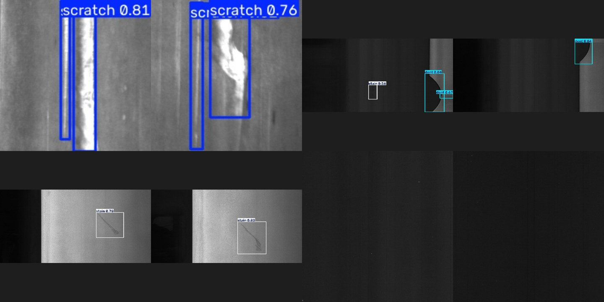
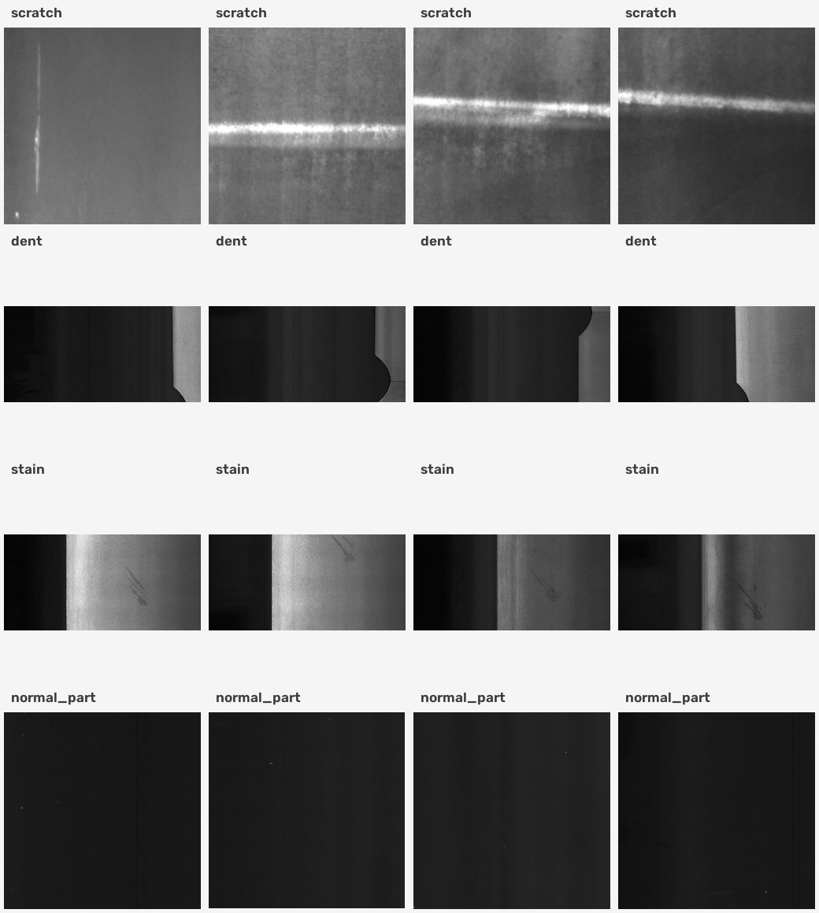
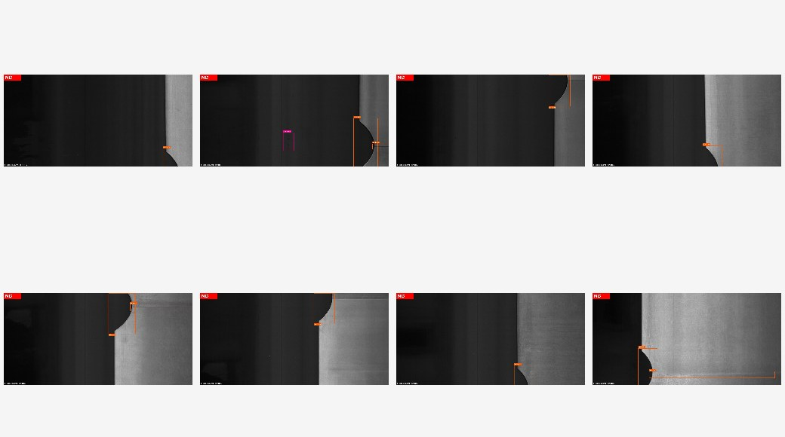
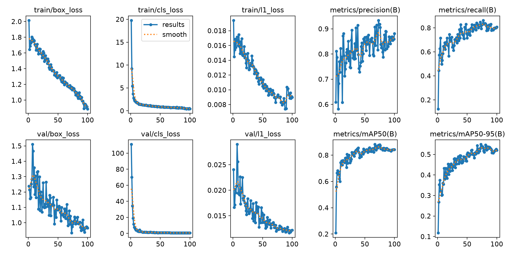
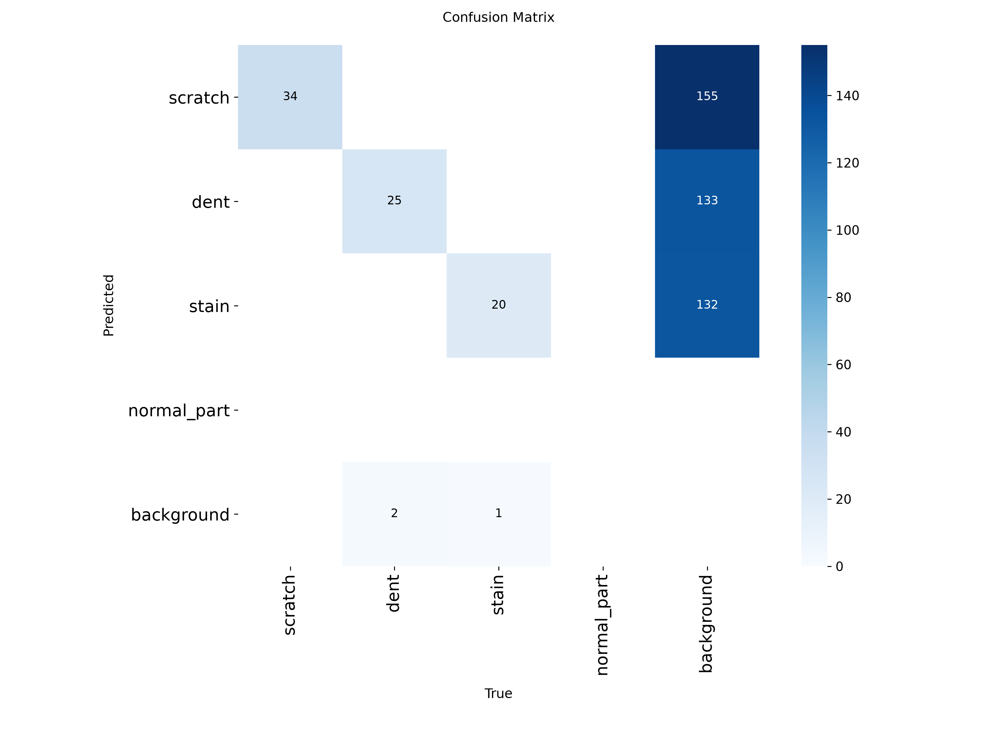
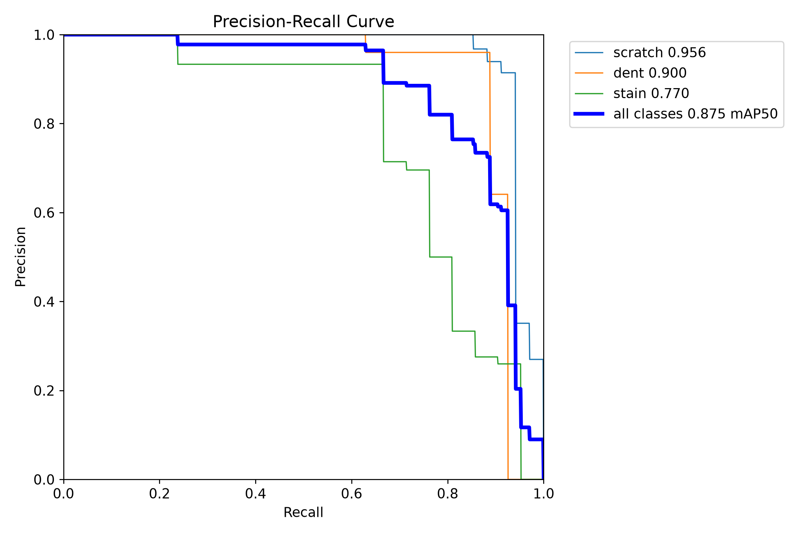

<div align="center">

# 🔍 基于YOLO模型的划痕检测系统

### MetalScan —— 低成本工业零件表面缺陷检测系统

**scratch 划痕 · dent 缺角/凹陷 · stain 脏污/锈斑 · normal_part 正常件**

[](https://www.python.org/)
[](https://pytorch.org/)
[](https://docs.ultralytics.com/)
[](https://onnx.ai/)
[](LICENSE)
[](#-快速开始)

**mAP@0.5 = 0.874** · 单帧推理 3ms (RTX 5060) · 网页端零插件实时检测 · 全流程可溯源

</div>

---

> 💡 **一句话介绍**：用百元级 USB 摄像头替代万元工业视觉系统，基于 NEU-DET + GC10-DET 双工业数据集训练的 YOLO26 模型，提供 **网页版实时检测 / 单图检测 / 批量检测** 三种模式，自动判定 OK / NG 并生成可导出的检测台账。

## 📸 效果展示

### 模型检测效果（验证集）



> 蓝/绿/黄框分别为 scratch（划痕）、dent（缺角）、stain（脏污）检测结果；normal_part 为无缺陷样本，模型正确输出无框判定。

### 数据集样例（四分类）



### 批量检测结果（预测类别 vs 真实类别）



---

## 📑 目录

- [项目亮点](#-项目亮点)
- [系统架构](#-系统架构)
- [模型性能](#-模型性能)
- [快速开始](#-快速开始)
- [Web 界面功能](#-web-界面功能)
- [命令行检测](#-命令行检测)
- [数据集构建（全流程溯源）](#-数据集构建全流程溯源)
- [训练流程](#-训练流程)
- [工程文件溯源总表](#-工程文件溯源总表)
- [目录结构](#-目录结构)
- [致谢](#-致谢)
- [License](#license)

---

## ✨ 项目亮点

| 亮点 | 说明 |
|------|------|
| 💰 **低成本** | USB 摄像头 + 补光灯（约 300~500 元）即可复现整套系统，对标万元工业方案 |
| 📚 **双数据集融合** | 融合 **NEU-DET**（东北大学热轧钢带缺陷库）与 **GC10-DET**（钢材表面缺陷库）两个学术基准数据集 |
| 🔄 **标注重映射** | 将两个异构数据集的 6 种原始缺陷自动映射为统一的四分类体系，含标注内容级校验 |
| ⚡ **轻量高速** | YOLO26n 仅 5.5MB，GPU 单帧 3ms；导出 ONNX 后可在无 GPU 机器上以 25ms/帧运行 |
| 🌐 **网页即开即用** | Flask + MJPEG 服务端推流，浏览器**零插件**实时检测，摄像头/单图/批量三模式 |
| 📋 **检测台账** | 所有检测记录 CSV 持久化，支持筛选、导出，防抖限流避免记录爆炸 |
| 🔍 **全链路溯源** | 数据来源、类别映射、训练超参、每个工程文件的生成方式全部可追溯（见[溯源总表](#-工程文件溯源总表)） |

---

## 🏗️ 系统架构

```
                        ┌─────────────────────────────────────────────┐
                        │              浏览器 (零插件)                  │
                        │   实时检测 · 图片检测 · 批量检测 · 台账 · 设置   │
                        └──────────────┬──────────────────────────────┘
                                       │ HTTP / MJPEG
                        ┌──────────────▼──────────────────────────────┐
                        │         Flask Web 服务 (web_app.py)          │
                        │  /video_feed  /api/detect  /api/batch_*  ... │
                        └──────┬───────────────────────┬──────────────┘
                               │                       │
                    ┌──────────▼─────────┐   ┌─────────▼──────────┐
                    │  CameraManager     │   │   检测台账           │
                    │  单一采集线程       │   │  内存 deque + CSV   │
                    │  热重连 / 防抖限流  │   │  持久化 / 导出      │
                    └──────────┬─────────┘   └────────────────────┘
                               │ BGR 帧
                        ┌──────▼──────────────────────────────────────┐
                        │      YOLO26n 检测模型 (weights/best.pt)      │
                        │   训练: NEU-DET + GC10-DET → 四分类重映射      │
                        │   部署: best.pt (GPU 3ms) / best.onnx (CPU)  │
                        └─────────────────────────────────────────────┘
```

---

## 📊 模型性能

| 指标 | 数值 |
|------|------|
| **mAP@0.5** | **0.874** |
| mAP@0.5:0.95 | 0.549 |
| scratch（划痕）AP50 | **0.955** |
| dent（缺角/凹陷）AP50 | 0.900 |
| stain（脏污/锈斑）AP50 | 0.769 |
| 训练规模 | 415 张（缺陷 245 + 正常 170），100 epochs，640×640 |
| 推理速度（RTX 5060 Laptop GPU） | **3.2 ms/帧** |
| 推理速度（ONNX / CPU） | ~25 ms/帧 |

### 训练曲线



### 混淆矩阵



### PR 曲线



---

## 🚀 快速开始

### 1️⃣ 环境要求

- Python ≥ 3.10（推荐 3.12）
- GPU（可选，无 GPU 自动回退 CPU / ONNX）

### 2️⃣ 安装依赖

```bash
git clone https://github.com/13shisan53/基于YOLO模型的划痕检测系统.git
cd 基于YOLO模型的划痕检测系统
pip install -r requirements.txt
```

### 3️⃣ 三种启动方式

```bash
# 方式 A：网页版（推荐，浏览器打开 http://localhost:8000）
python web_app.py

# 方式 B：命令行摄像头实时检测（Q 退出 / S 抓拍）
python metal_scan_app.py --camera

# 方式 C：批量检测 images 目录测试图
python metal_scan_app.py --folder dataset_samples --save results
```

Windows 用户也可直接双击 `run_web.bat` 一键启动网页版。

> 📷 摄像头模式建议：低角度侧光照射被测零件，划痕类缺陷在侧光下对比度最高，检出效果最佳。

---

## 🖥️ Web 界面功能

| 页面 | 功能 |
|------|------|
| **◉ 实时检测** | 摄像头画面实时推理（MJPEG 服务端推流），OK/NG 大字判定，实时 FPS、OK/NG 占比统计 |
| **◫ 图片检测** | 拖拽/点击上传单张图片，返回标注图 + 每处缺陷置信度明细 |
| **▦ 批量检测** | 一次上传多张（≤12）或检测服务器样例目录，结果网格 + OK/NG 汇总 |
| **☰ 检测记录** | 全部检测记录持久化（CSV），按来源筛选，一键导出/清空 |
| **⚙ 系统设置** | 默认置信度阈值、模型信息（架构/精度/设备/数据集） |

特性：
- 摄像头由**单一采集线程**管理，显式开关 + 读取失败热重连，反复启停不失效
- 台账**防抖限流**：判定需稳定 0.6s 才记录 + 3s 心跳，30fps 下不会写爆记录
- 置信度阈值滑杆实时生效，设置本地记忆

---

## 💻 命令行检测

`metal_scan_app.py` 支持三种模式与常用参数：

```bash
python metal_scan_app.py --camera --conf 0.45          # 摄像头实时（默认优先加载 ONNX）
python metal_scan_app.py --image test.jpg              # 单图检测
python metal_scan_app.py --folder dir --limit 24 --save results   # 批量检测
python metal_scan_app.py --camera --no-onnx            # 强制使用 PyTorch 权重
```

判定逻辑：画面中检出任意 scratch / dent / stain 缺陷 → **NG**（红色横条 + 蜂鸣扩展位）；否则 **OK**（绿色横条）。

---

## 📦 数据集构建（全流程溯源）

> 完整溯源说明见 [`docs/DATA_PROVENANCE.md`](docs/DATA_PROVENANCE.md)

### 来源

| 数据集 | 来源 | 原始规模 | 用途 |
|--------|------|----------|------|
| **NEU-DET** | 东北大学热轧钢带缺陷库（GitHub 开源镜像 `gg123654/all-Dataset`） | 1620 张 / 6 类 | 划痕（scratches） |
| **GC10-DET** | 钢材表面缺陷基准库（同上镜像） | 2001 张 / 7 类 | 缺角、脏污、正常件裁剪源 |

### 类别映射规则

| 原始数据集 | 原始类别 | → | 本系统类别 | 标注 ID |
|------------|----------|---|-----------|---------|
| NEU-DET | scratches（划痕） | → | `scratch` | 0 |
| GC10-DET | crescent_gap（月牙缺口）、punching（冲孔） | → | `dent` | 1 |
| GC10-DET | oil_spot（油斑）、water_spot（水斑） | → | `stain` | 2 |
| 双数据集 | 缺陷框以外的无缺陷表面区域裁剪 | → | `normal_part` | 3（负样本，空标签） |

### 构建流程

```
GitHub 镜像仓库 tree.json → 按标注文件内容(非文件名!)筛选候选图 → 可视化人工抽检校验
→ 标注类别 ID 重映射 (0/1/2) → PIL 完整性校验 → 8:2 划分 train/val
→ 从无缺陷区域随机裁剪生成 normal_part (170 张, 避让缺陷框 ≥12px)
```

> ⚠️ **关键坑**：该镜像仓库 GC10 部分的**文件名类别码与标注内容不一致**（仓库处理时被重排），必须以标注文件中的真实类别 ID 为准筛选。本系统的 415 张训练集全部经过标注内容级校验。

### 数据样例

`dataset_samples/` 内每类 4 张样例（含标签），完整 415 张数据集按 [溯源文档](docs/DATA_PROVENANCE.md) 的流程从原始数据集重建。

---

## 🏋️ 训练流程

```bash
# 一键训练（自动下载 YOLO26n 预训练权重）
python train_yolo26.py --epochs 100 --imgsz 640 --batch 16 --device 0
```

训练完成后自动执行：
1. ✅ 验证集评估（输出 mAP 与各类 AP50）
2. ✅ 导出 ONNX（`weights/best.onnx`，含 onnxruntime 冒烟测试）
3. ✅ 生成验证集预测可视化图（`val_predictions/`）

训练产物：`results.csv`（逐 epoch 指标）、训练曲线、混淆矩阵、PR 曲线等见 `docs/images/`。

<details>
<summary><b>训练超参数（点击展开）</b></summary>

```yaml
model:        yolo26n.pt (预训练)
epochs:       100
imgsz:        640
batch:        16
optimizer:    auto (SGD/AdamW 自动选择)
patience:     30 (早停)
seed:         42
数据增强:      YOLO 内置默认 (Mosaic / HSV / 翻转 / 缩放)
```

</details>

---

## 🗂️ 工程文件溯源总表

> **每个文件是什么、从哪来、如何生成** —— 一一对应，全链路可溯源。

| 文件 / 目录 | 说明 | 来源与生成方式 |
|-------------|------|----------------|
| `web_app.py` | Web 服务主体（Flask + 摄像头线程 + 模型推理 + 前端页面） | 本项目手写，全部功能经接口级实测 |
| `metal_scan_app.py` | 命令行检测（摄像头 / 单图 / 批量，ONNX 优先） | 本项目手写 |
| `train_yolo26.py` | YOLO26 训练 + 评估 + ONNX 导出 + 可视化 | 本项目手写 |
| `dataset.yaml` | 数据集配置（类别名 / 路径） | 本项目按四分类体系编写 |
| `dataset/data.yaml` | train/val 8:2 划分版数据集配置 | 由划分脚本生成，seed=42 可复现 |
| `requirements.txt` | 依赖清单 | 本项目手写（版本为实测通过版本） |
| `run_web.bat` | Windows 一键启动网页版 | 本项目手写 |
| `weights/best.pt` | PyTorch 训练权重 (5.5MB) | YOLO26n 在本数据集上训练 100 epochs 产出（mAP50=0.874） |
| `weights/best.onnx` | ONNX 部署权重 (9.85MB) | Ultralytics `export(format='onnx')` 从 best.pt 导出，经 onnxruntime 冒烟测试 |
| `dataset_samples/*/` | 四分类样例图（每类 4 张） | 从训练集抽样复制，完整训练集见溯源文档 |
| `docs/images/training_curve.png` | 训练曲线（loss / mAP 逐 epoch） | Ultralytics 训练框架自动生成 |
| `docs/images/confusion_matrix.png` | 混淆矩阵 | 同上 |
| `docs/images/PR_curve.png` | PR 曲线 | 同上 |
| `docs/images/train_batch.jpg` | 训练批次增强可视化（Mosaic 等） | 同上 |
| `docs/images/val_pred_grid.jpg` | 验证集预测可视化拼图 | best.pt 推理 + OpenCV 拼图脚本生成 |
| `docs/images/val_pred_random.jpg` | 验证集随机样本预测拼图 | 同上 |
| `docs/images/dataset_samples.jpg` | 四分类数据样例拼图 | OpenCV 拼图脚本生成 |
| `docs/images/batch_test_grid.jpg` | 批量检测结果拼图（含预测/真值对比） | 批量检测实测输出 |
| `docs/results.csv` | 逐 epoch 训练指标原始数据 | Ultralytics 训练框架自动记录 |
| `docs/DATA_PROVENANCE.md` | 数据集全流程溯源文档 | 本项目编写 |
| `LICENSE` / `.gitignore` / `README.md` | 开源配套文件 | 本项目编写 |

---

## 📁 目录结构

```
基于YOLO模型的划痕检测系统
├── README.md                  # 本文件
├── LICENSE                    # MIT License
├── requirements.txt           # Python 依赖
├── run_web.bat                # Windows 一键启动
├── web_app.py                 # ⭐ Web 服务（实时/单图/批量/台账）
├── metal_scan_app.py          # 命令行检测工具
├── train_yolo26.py            # 训练 + 导出脚本
├── dataset.yaml               # 数据集配置
├── dataset/
│   └── data.yaml              # train/val 划分版配置
├── weights/
│   ├── best.pt                # PyTorch 权重 (5.5MB)
│   └── best.onnx              # ONNX 部署权重 (9.85MB)
├── dataset_samples/           # 四分类样例图
│   ├── scratch/  ├── dent/
│   ├── stain/    └── normal_part/
└── docs/
    ├── DATA_PROVENANCE.md     # 数据集溯源文档
    ├── results.csv            # 训练原始指标
    └── images/                # README 配图与训练产物
```

---

## 🙏 致谢

- [NEU Surface Defect Database (NEU-DET)](https://pubmed.ncbi.nlm.nih.gov/23608229/) — 东北大学热轧钢带表面缺陷数据集
- [GC10-DET](https://arxiv.org/abs/1906.06475) — 钢材表面缺陷基准数据集
- [Ultralytics YOLO](https://github.com/ultralytics/ultralytics) — YOLO26 训练与推理框架
- [ONNX Runtime](https://onnxruntime.ai/) — 跨平台部署推理引擎
- 数据集镜像仓库 [gg123654/all-Dataset](https://github.com/gg123654/all-Dataset)

## License

本项目采用 [MIT License](LICENSE) 开源。数据集版权归原机构所有，仅用于学术研究。

---

<div align="center">

**如果这个项目对你有帮助，欢迎点一个 ⭐ Star**

Made with ❤️ by [13shisan53](https://github.com/13shisan53)

</div>
